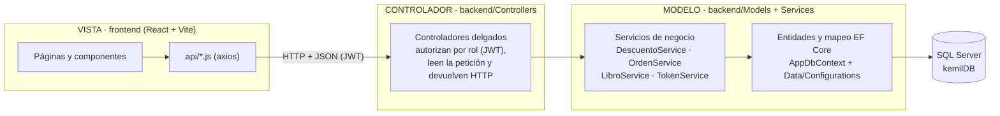

# Kem'il Editorial

Plataforma web de la editorial: catálogo y compra de libros, pedidos especiales (cotizaciones) y panel de administración.

- **Backend:** ASP.NET Core (net10.0) + Entity Framework Core + SQL Server
- **Frontend:** React 19 + Vite

## Arquitectura (MVC)

El proyecto aplica el patrón **Modelo-Vista-Controlador** con una separación estricta de responsabilidades. El frontend es la **Vista**, y el backend se divide en **Controlador** y **Modelo**.



| Capa | Dónde vive | Qué hace | Qué NO hace |
|---|---|---|---|
| **Vista** | `frontend/src` | Muestra datos, valida formularios al escribir y llama a la API. | No calcula descuentos, no conoce la base de datos y su control de acceso es solo visual. |
| **Controlador** | `backend/Controllers` | Recibe la petición, exige el rol, llama al Modelo y traduce el resultado a un código HTTP (200, 400, 404, 409...). | No contiene reglas de negocio ni consultas SQL. |
| **Modelo** | `backend/Models`, `backend/Services`, `backend/Data` | Reglas de negocio (descuentos, stock, validaciones), entidades y acceso a datos con EF Core. | No conoce HTTP ni HTML. |

### Estructura de carpetas

```text
kemil/
├── backend/                         API ASP.NET Core (net10.0)
│   ├── Controllers/                 CONTROLADOR: Auth, Libros, Catalogo, Ordenes, Cotizaciones, Usuarios, Roles, Admin
│   ├── Models/                      MODELO: entidades y servicios de negocio
│   │   ├── DescuentoService.cs        motor de descuentos (lógica pura)
│   │   ├── OrdenService.cs            cierre de orden, stock y facturas
│   │   ├── LibroService.cs            validación y CRUD del catálogo, portadas
│   │   └── *.cs                       Libro, Autor, Factura, Usuario...
│   ├── Services/                    TokenService (JWT)
│   ├── Auth/                        constantes de roles
│   ├── Data/Configurations/         mapeo de tablas a clases (EF Core)
│   ├── DTOs/                        objetos que viajan por la API
│   ├── KemilEditorial.Tests/        pruebas unitarias (xUnit)
│   ├── AppDbContext.cs, Program.cs  contexto de datos y arranque (JWT, CORS, seguridad)
│   └── uploads/portadas/            portadas subidas desde el panel (no se sube a Git)
├── frontend/                        VISTA (React 19 + Vite)
│   ├── public/portadas/             portadas de los libros de ejemplo (SVG)
│   └── src/
│       ├── pages/                   Home, Catálogo, Carrito, Login, Registro, admin/, asesor/
│       ├── components/              BookCard, BookModal, CartDrawer, QuoteModal...
│       ├── context/                 sesión, carrito y mensajes
│       ├── api/                     llamadas al backend (axios)
│       ├── routes/                  rutas y ProtectedRoute por rol
│       └── utils/, hooks/           utilidades
└── database/                        scripts SQL y respaldo kemilDB.bak
```

### Qué pasa al comprar (flujo completo)

1. **Vista:** el cliente agrega libros al carrito. `CartContext` guarda el carrito en el navegador, pero al cerrar la orden la Vista envía solo `idLibro` y `cantidad`.
2. **Vista → Controlador:** `POST /api/ordenes` con el token JWT. El controlador comprueba que el rol sea Cliente, Mayorista o Institucional.
3. **Controlador → Modelo:** `OrdenService` ignora cualquier precio que mande el cliente y lee el precio real de la base de datos.
4. **Modelo:** `DescuentoService` calcula el desglose. El tipo de cliente sale del rol del token, no del cuerpo de la petición.
5. **Modelo:** se valida el stock de todos los libros y, solo si alcanza, se descuenta. Todo ocurre en una transacción: se guarda la factura completa o no se guarda nada.
6. **Respuesta:** el servidor devuelve el desglose (subtotal, descuentos con su regla, IVA y total) y la Vista lo muestra.

### Reglas de descuento (RF-03.2)

Se calculan únicamente en `DescuentoService`. Cada monto se redondea a 2 decimales (medio centavo hacia arriba), así que las cifras siempre suman exactamente el total.

| Unidades en el carrito | Descuento por volumen |
|---|---|
| 1 a 5 | 0 % |
| 6 a 20 | 5 % |
| 21 a 50 | 10 % |
| Más de 50 | 15 % |

Después del volumen, los clientes **Mayorista e Institucional** reciben un **8 % adicional acumulativo** (sobre lo que queda tras el descuento por volumen, no sobre el subtotal base). Al final se aplica el **IVA del 12 %**.

Ejemplo: 10 libros de Q100 para un cliente institucional → subtotal 1,000.00; volumen 5 % = 50.00; cliente 8 % de 950 = 76.00; subtotal con descuentos 874.00; IVA 104.88; **total 978.88**.

## Cómo levantar el proyecto

### Base de datos
Cada desarrollador trabaja con su propia instancia local de SQL Server, restaurada desde el respaldo oficial `kemilDB.bak`. Los pasos están en [`database/README.md`](database/README.md).

Después de restaurar, ejecuta `database/usuarios_prueba.sql`. Crea los roles Mayorista e Institucional y los cinco usuarios de prueba de la tabla de abajo. Se puede ejecutar más de una vez sin duplicar datos.

Los demás scripts de `database/` (`schema.sql`, `seed.sql`, `seed_catalogo.sql`, `seed_portadas.sql`) son de referencia y de carga de datos del catálogo.

### Backend
```powershell
cd backend
dotnet run
```
Escucha en `http://localhost:5229` (Swagger en `/swagger`).

La cadena de conexión real va en `backend/appsettings.Development.json`, que **no se sube a Git**. Ahí se sobrescribe `ConnectionStrings:DefaultConnection`. Los valores de `appsettings.json` son solo de desarrollo local; en producción se debe cambiar `Jwt:Key`.

### Frontend
```powershell
cd frontend
npm install
npm run dev
```
Abre `http://localhost:5173`. Por defecto consume `http://localhost:5229/api`; para otro entorno se crea `frontend/.env` con `VITE_API_URL=...`.

## Usuarios de prueba

Contraseña de todos: `Kemil2026!` (solo para desarrollo).

| Rol | Correo |
|---|---|
| Administrador | admin@kemileditorial.com |
| Asesor | asesor@kemileditorial.com |
| Cliente (minorista) | cliente@kemileditorial.com |
| Mayorista | mayorista@kemileditorial.com |
| Institucional | institucional@kemileditorial.com |

## Autenticación y control de acceso

- **Contraseñas:** se guardan con BCrypt (factor de trabajo 12). Nunca se almacenan ni se devuelven en texto plano.
- **Sesión:** JWT de 60 minutos con id, nombre, correo y rol. En cada petición el servidor vuelve a comprobar en la base que el usuario siga activo y conserve el mismo rol, de modo que desactivar una cuenta o cambiarle el rol surte efecto de inmediato.
- **Denegar por defecto:** todo endpoint exige sesión salvo los marcados como públicos (`[AllowAnonymous]`). Una ruta nueva sin atributos queda protegida.
- **Login:** limitado a 5 intentos por minuto por IP.
- **Registro público:** siempre crea usuarios con rol Cliente. Los demás roles solo los asigna un administrador.
- **Frontend:** `ProtectedRoute` oculta las pantallas por rol, pero solo es comodidad visual. La seguridad real está en el backend.

### Qué puede hacer cada rol

| Acción | Público | Cliente | Mayorista | Institucional | Asesor | Administrador |
|---|:-:|:-:|:-:|:-:|:-:|:-:|
| Ver catálogo, calcular carrito | ✔ | ✔ | ✔ | ✔ | ✔ | ✔ |
| Comprar (crear orden) y ver sus pedidos | | ✔ | ✔ | ✔ | | |
| Solicitar cotización (pedido especial) | | | ✔ | ✔ | | |
| Ver y responder cotizaciones | | | | | ✔ | ✔ |
| Usuarios, roles, resumen y monitoreo de órdenes | | | | | | ✔ |

Un rol sin permiso recibe **403**; sin sesión, **401**.

## Pedidos especiales (cotizaciones)

Los clientes Mayorista e Institucional envían una solicitud. El personal (Asesor o Administrador) la responde con un monto y observaciones. Una cotización ya cerrada (respondida o rechazada) no se puede modificar: responde **409**.

En la base los estados son `Pendiente`, `En revision`, `Cotizada`, `Aprobada` y `Rechazada`. La API traduce `Cotizada` a `Respondida` y `En revision` a `En revisión` para el frontend.

## Endpoints principales

| Método | Ruta | Acceso |
|---|---|---|
| POST | `/api/auth/registro` | Público |
| POST | `/api/auth/login` | Público (limitado) |
| GET | `/api/auth/me` | Sesión |
| POST | `/api/auth/usuarios` | Administrador |
| GET | `/api/usuarios` | Administrador |
| PUT | `/api/usuarios/{id}/rol` | Administrador |
| PUT | `/api/usuarios/{id}/estado` | Administrador |
| GET | `/api/roles` | Administrador |
| POST | `/api/cotizaciones` | Mayorista, Institucional |
| GET | `/api/cotizaciones/bandeja` | Asesor, Administrador |
| PUT | `/api/cotizaciones/{id}/responder` | Asesor, Administrador |
| GET | `/api/admin/resumen` | Administrador |
| GET | `/api/ordenes?estado=` | Administrador |
| POST | `/api/ordenes` | Cliente, Mayorista, Institucional |
| GET | `/api/ordenes/mis-pedidos` | Cliente, Mayorista, Institucional |
| GET | `/api/libros` | Público (incluye autor, editorial, año, stock y portada) |
| POST | `/api/ordenes/calcular` | Público (vista previa del carrito) |
| POST | `/api/libros` | Administrador |
| PUT | `/api/libros/{id}` | Administrador |
| DELETE | `/api/libros/{id}` | Administrador (eliminación lógica) |
| POST | `/api/libros/{id}/portada` | Administrador (JPG, PNG o WebP, máx. 2 MB) |
| GET | `/api/generos` | Administrador, Asesor |
| GET | `/api/editoriales` | Administrador, Asesor |

## Catálogo y portadas

- **Datos de ejemplo:** `database/seed_catalogo.sql` carga 14 libros con precio, autores, editoriales e inventario. Se puede ejecutar varias veces sin duplicar datos.
- **Portadas de ejemplo:** `database/seed_portadas.sql` asigna a cada libro una imagen de `frontend/public/portadas/`. Para regenerarlas: `node scripts/generar-portadas.mjs` desde `frontend`.
- **Portadas propias:** desde el panel de administración (Catálogo → Nuevo libro / Editar) se elige una imagen al guardar el libro. El servidor comprueba el tipo real del archivo, genera el nombre y la guarda en `backend/uploads/portadas/`.
- **Stock:** el campo del formulario fija las existencias totales del libro. Si hay varias bodegas, al subir se suma a la primera y al bajar se descuenta de la que tiene más. Los e-books no tienen stock.
- **Validaciones del servidor:** título obligatorio, precio mayor que cero con hasta 2 decimales, ISBN de 10 o 13 dígitos y único, formato permitido (Tapa blanda, Tapa dura o E-book), género y editorial existentes, y rechazo de `<` y `>` en los textos.

## Pruebas

```powershell
cd backend
dotnet test KemilEditorial.Tests
```

Las pruebas cubren el motor de descuentos (límites de cada tramo, redondeo y validaciones), el cierre de orden (precio desde la base, stock, transacción) y el catálogo (validaciones, stock, autores y portadas). Usan SQLite en memoria, así que no tocan la base real.

## Orden de los scripts SQL

1. Restaurar `kemilDB.bak` (o ejecutar `schema.sql` y `seed.sql` en una base vacía).
2. `usuarios_prueba.sql`: roles y los cinco usuarios de prueba.
3. `seed_catalogo.sql`: libros, autores, editoriales e inventario.
4. `seed_portadas.sql`: asigna las portadas.
5. Antes de la entrega: `limpiar_datos_prueba.sql` borra las órdenes y cotizaciones de prueba (por defecto solo simula; ver el comentario del script).
